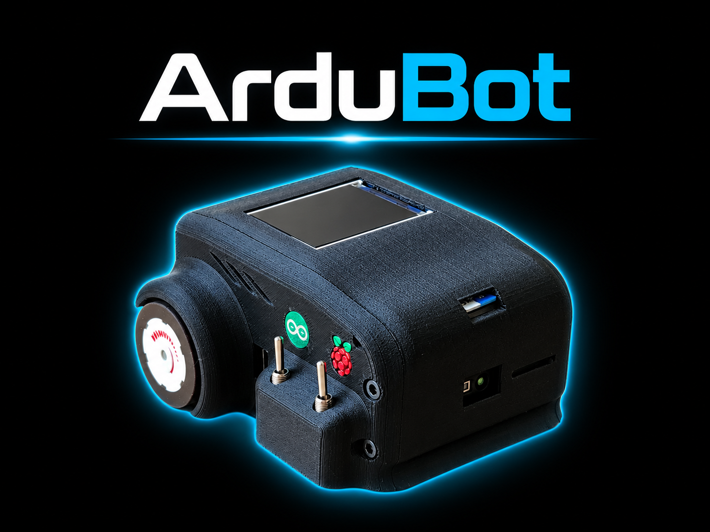
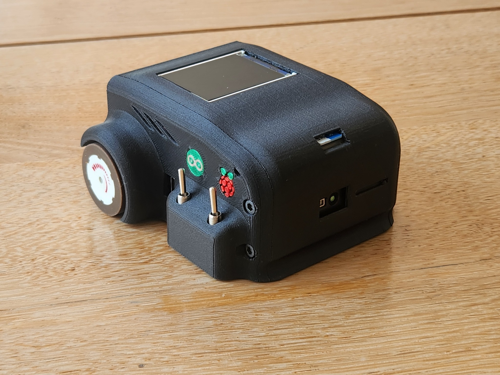
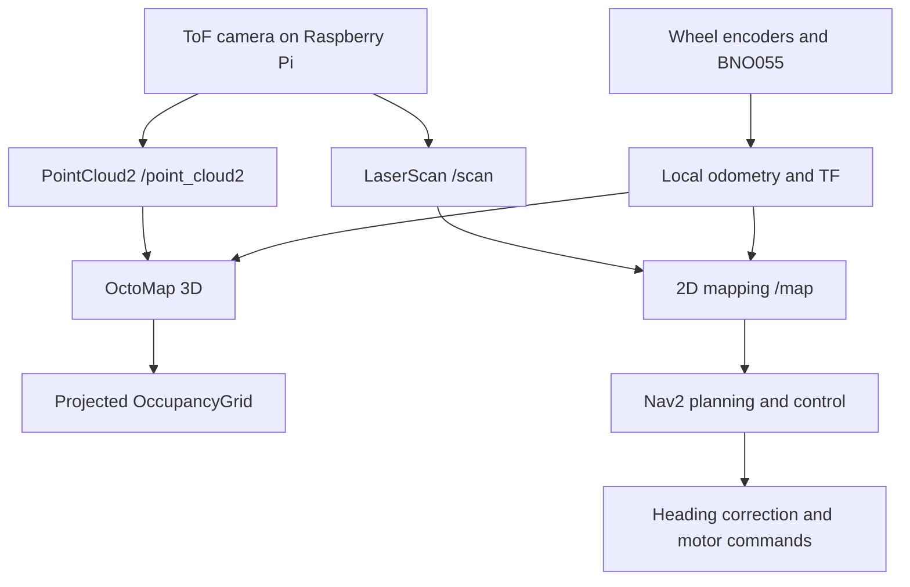
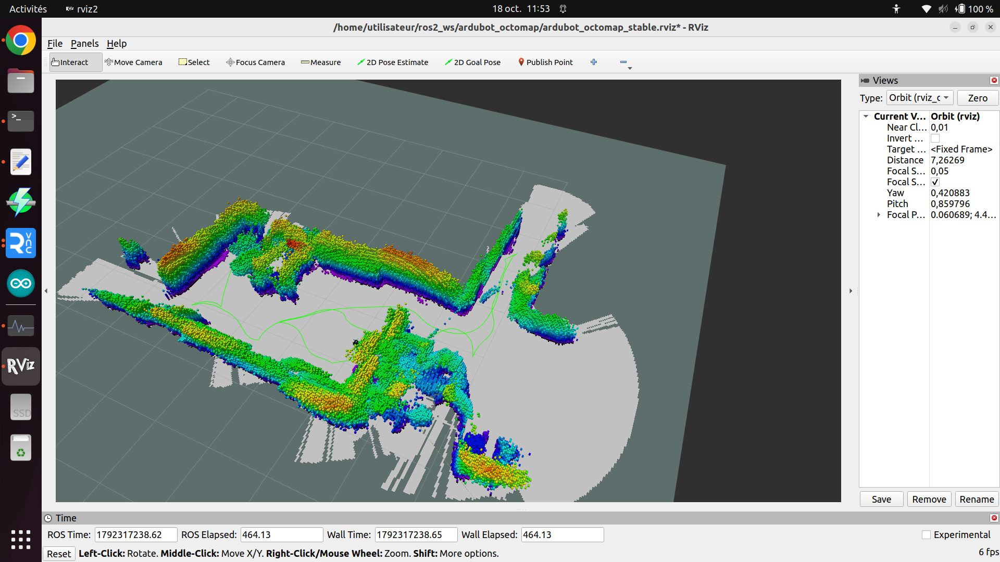
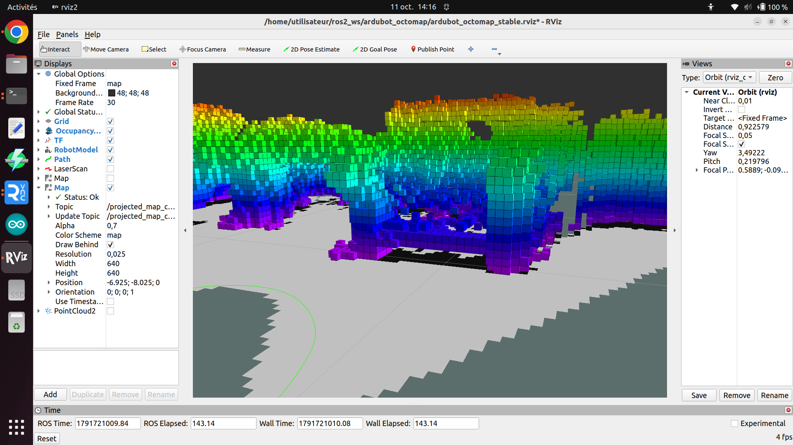
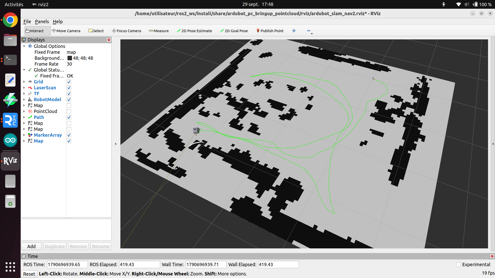

<p align="center">
  
</p>

# ArduBot — ToF Mapping & ROS 2 Navigation

**A compact differential-drive robot that combines an Arducam Time-of-Flight camera, wheel encoders and a BNO055 IMU to explore indoor environments, build maps and experiment with autonomous navigation.**

ArduBot connects three layers: Arduino for motor and sensor control, a Raspberry Pi for camera acquisition and robot communication, and a PC running ROS 2 Humble for odometry, mapping, visualization and Nav2 navigation. The project brings together real-time robot control, 3D perception and occupancy-grid mapping in a small robotic platform.

This repository provides a compact source release: one Arduino firmware reference, the Raspberry Pi programs, the required PC ROS packages, the robot model and the configurations needed to understand and assemble the stack.

[Hardware](#hardware) · [Architecture](#system-architecture) · [Mapping](#2d-and-3d-mapping) · [Screenshots](#development-screenshots) · [Getting started](#getting-started) · [Status](#current-status-and-validation)

## Project overview

The aim is to investigate how a small mobile robot can perceive nearby obstacles and represent its surroundings using a forward-facing depth camera. Rather than treating the camera as a conventional image sensor, ArduBot uses its depth measurements to reconstruct a 3D point cloud and derive a planar laser-like scan.

Those two representations serve different purposes:

- **2D mapping and navigation:** a `LaserScan` supports map creation and the Nav2 navigation stack.
- **3D reconstruction:** a `PointCloud2` feeds OctoMap to accumulate a volumetric occupancy model.
- **Projected occupancy grids:** a height-selected projection of the 3D model provides a 2D view of low obstacles, complemented by a persistent field-of-view clearing layer.

Wheel encoders provide travel information, while the BNO055 provides heading information. Chrony synchronizes the Raspberry Pi and PC clocks so camera measurements, odometry and transforms can share a consistent timeline.

## Main features

| Area | Implementation |
|---|---|
| Motor control | Arduino firmware with independent wheel PI regulation, encoder feedback, command timeout and out-of-range command rejection |
| Depth acquisition | Arducam ToF driver publishing a direct scan and a filtered `PointCloud2` |
| Camera geometry | Radial depth projection using the selected 62.8° × 37.9° field of view |
| Point-cloud processing | Local median/foreground processing, detail-preserving selection, voxel reduction and a configurable point budget |
| Local odometry | Encoder-derived travel combined with BNO055 heading; separate raw and corrected odometry frames |
| Heading control | BNO055-based heading correction in the Nav2 command chain |
| 2D mapping | SLAM Toolbox resources and a retained odometry-based mapping profile |
| 3D mapping | OctoMap with a reference resolution of 25 mm |
| Occupancy projection | `/projected_map` and the persistent `/projected_map_cleared` visualization layer |
| Navigation | Nav2 configuration, planning/control launch resources and velocity smoothing |
| Robot visualization | URDF, wheel/chassis STL meshes and RViz configuration |
| Distributed ROS | Domain 10 on the Raspberry Pi and domain 20 on the PC, linked through a domain bridge |
| Clock synchronization | Chrony with the PC as NTP master and the Raspberry Pi as client |

## Hardware

<p align="center">
  
</p>

*The physical ArduBot prototype. The header image uses the project's existing branded artwork.*

| Component | Role |
|---|---|
| Raspberry Pi 4 | Runs camera acquisition, the UART bridge and the inter-domain ROS bridge |
| Arducam ToF V2 | Measures depth in front of the robot |
| Arduino-compatible motor controller | Runs the selected motor/encoder/BNO055 sketch; requires the controller's `microM` library |
| Two geared motors with encoders | Differential-drive propulsion and wheel-travel measurement |
| BNO055 IMU | Supplies orientation, angular velocity and calibration information |
| PC with Ubuntu 22.04 / ROS 2 Humble | Runs the PC-side estimation, mapping, Nav2 and RViz programs |
| Robot chassis and wheels | Described by the supplied URDF and three STL resources |

The selected source configuration uses **30 mm wheel diameter**, **78.4 mm wheel track**, **348 encoder ticks per wheel revolution** and a **115200-baud UART**. Motor commands are wheel velocities in **m/s**. These settings belong to this source selection and must be checked against the actual motor/controller assembly.

## System architecture

### Arduino: low-level control

The firmware reads wheel encoders, acquires BNO055 measurements and regulates the two motors. The serial protocol includes wheel commands, encoder counters, IMU data, magnetic-field measurements and calibration state.

The selected firmware reference is **V24 SOFT_GUARD + CMD_VEL_REJECTED**. A command timeout stops the motors when fresh commands stop arriving; an out-of-range wheel command is rejected rather than executed. The repository does not establish which exact variant is currently flashed on the original robot.

### Raspberry Pi: acquisition and communication

The Raspberry Pi runs the serial node and the ToF driver. The camera publishes `/scan` directly; a second point-cloud-to-scan converter is not required in this assembly.

A compact `PointCloud2` is forwarded to the PC for 3D processing. Detail-preserving filtering reduces the number of points assigned to smooth surfaces while retaining useful foreground structure. This is intended to reduce transport and processing load; actual update rates depend on the camera, parameters, CPU load and Wi-Fi link.

### PC: estimation, maps and navigation

The PC combines encoder travel and IMU heading into the BNO/encoder odometry estimate, maintains the robot model, builds the maps and runs Nav2. The command chain is:

`Nav2 → velocity smoother → heading corrector → /cmd_vel → Raspberry Pi → Arduino`

The TF chain separates each responsibility:

`map → odom_bno → odom → base_link → robot sensor and wheel frames`

The Raspberry Pi owns the raw `odom → base_link` transform. PC odometry publishes the `odom_bno → odom` correction. The URDF provides the fixed sensor frames, and the retained mapping profile provides the static `map → odom_bno` transform.

## 2D and 3D mapping



### 2D map and navigation

The direct scan is used by the mapping and navigation resources. The supplied Nav2 configuration handles planning and velocity control, with a heading-correction stage before commands reach the robot.

**The retained October mapping profile has scan matching and loop closure disabled.** It places measurements using the local odometry estimate and a static `map → odom_bno` transform. It therefore does not currently apply active SLAM pose corrections or loop-closure corrections. Enabling those functions requires a coordinated change to the map/odom TF ownership; it is not a single independent toggle.

### OctoMap and occupancy projection

The 3D path is:

`/point_cloud2 → octomap_server → /projected_map → /projected_map_cleared`

The compact launch selects a **0.025 m OctoMap resolution**, a **2.5 m sensor range** and a **0.00–0.06 m vertical band for occupancy projection**. These are reference settings from the selected configuration, not a statement of camera accuracy or universal obstacle-detection performance.

The projected clearing node uses current obstacles from the latest projection and retains an independent history of cells estimated to be free. It starts with a **16 × 16 m grid** and can expand in **2 m blocks**. Its virtual field of view uses **62.8°**, a **2.5 m range** and an **85 mm forward camera offset**.

Old occupied positions are not accumulated by the clearing layer. Current obstacles take priority over the persistent free-space history. The layer does not subscribe to `/scan`.

`/projected_map_cleared` is a visualization aid in this release. It is **not connected as a safety map to the Nav2 costmaps**, and a previously observed field of view does not prove that an area is currently obstacle-free.

## Development screenshots

These captures come from the original development setup. They illustrate the robot project, not a fresh end-to-end validation of this compact repository. In particular, the screenshots use the development RViz layout and OctoMap display; the included lightweight RViz configuration is different.

### 3D occupancy model and estimated trajectory



*A 3D occupancy model and an estimated trajectory shown together in RViz. The trajectory is an estimate, not external ground truth.*

### Height-selected projection and obstacle structure



*A close-up of the voxel model over a projected occupancy grid. The development display shows a 0.025 m grid resolution.*

### 2D occupancy map and live scan



*A 2D occupancy grid, a scan and the robot's trajectory in the development interface. This is a separate 2D map view, not the 3D projection above.*

## ROS interfaces

| Interface | Type | Purpose |
|---|---|---|
| `/scan` | `sensor_msgs/msg/LaserScan` | Direct planar scan derived from the ToF measurements |
| `/point_cloud2` | `sensor_msgs/msg/PointCloud2` | Filtered point cloud transported to the PC |
| `/odom` | `nav_msgs/msg/Odometry` | Raw wheel odometry from the serial node |
| `/imu` | `sensor_msgs/msg/Imu` | BNO055 orientation and motion measurements |
| `/left_ticks`, `/right_ticks` | `std_msgs/msg/Int64` | Cumulative wheel-encoder counters |
| `/imu/calibration` | `std_msgs/msg/UInt8MultiArray` | BNO055 calibration state |
| `/odom_bno_encoder` | `nav_msgs/msg/Odometry` | Local BNO/encoder pose estimate |
| `/joint_states` | `sensor_msgs/msg/JointState` | Encoder-based wheel visualization |
| `/map` | `nav_msgs/msg/OccupancyGrid` | 2D mapping output |
| `/projected_map` | `nav_msgs/msg/OccupancyGrid` | Height-selected projection of the OctoMap |
| `/projected_map_cleared` | `nav_msgs/msg/OccupancyGrid` | Projected map with persistent FOV free-space history |
| `/cmd_vel` | `geometry_msgs/msg/Twist` | Final velocity command sent towards the robot |
| `/tf`, `/tf_static` | `tf2_msgs/msg/TFMessage` | Dynamic and fixed coordinate transforms |

These are stack-level interfaces. The bridge transports only the selected inter-machine streams; not every local topic crosses both ROS domains.

## Clock synchronization and Wi-Fi

The Raspberry Pi and PC use different ROS domains but need compatible wall-clock timestamps. Chrony is configured with the **PC as the NTP master** and the **Raspberry Pi as its client**. The PC can follow Internet NTP when available and use its local stratum-8 fallback on an isolated network.

The example client hostname is `ardubot-pc.local`; replace it with the real PC hostname. Before starting the distributed stack, check `chronyc tracking` and `chronyc sources -v` on both machines.

Clock synchronization and wireless bandwidth solve different problems. Chrony aligns timestamps; point-cloud filtering reduces the amount of sensor data transported. A synchronized system can still lose performance on a weak or congested Wi-Fi link.

## Repository layout

| Path | Contents |
|---|---|
| [`arduino/`](arduino/) | Selected firmware and Arduino dependency notes |
| [`raspberry_ws/src/`](raspberry_ws/src/) | ToF driver, serial bridge and Raspberry bringup |
| [`pc_ws/src/`](pc_ws/src/) | BNO/encoder odometry, heading correction, description, PC bringup and projected-grid packages |
| [`config/chrony/`](config/chrony/) | PC-master and Raspberry-client clock configurations |
| [`docs/BUILD_AND_RUN.md`](docs/BUILD_AND_RUN.md) | Build, installation, startup and TF guidance |
| [`docs/SOURCE_SELECTION.md`](docs/SOURCE_SELECTION.md) | Selected source versions and assembly changes |
| [`docs/VERIFICATION.md`](docs/VERIFICATION.md) | Checks performed and their limits |
| [`docs/images/`](docs/images/) | Project branding, prototype photograph and development screenshots |

The repository deliberately keeps one selected source version per component. Development archives, diagnostic recordings and generated build directories are not included.

## Getting started

### 1. Install the external dependencies

The target middleware is **ROS 2 Humble**. The PC reference platform is **Ubuntu 22.04**; the Raspberry project used **Raspberry Pi OS Bullseye with an existing ROS installation**. This repository does not install ROS itself.

You also need:

- The manufacturer's Arducam depth-camera SDK, providing `ArducamTOFCamera.hpp` and `libArducamDepthCamera`.
- The Arduino **Adafruit BNO055** and **Adafruit Unified Sensor** libraries.
- The motor controller's **microM** library, supplied separately; see [Arduino dependencies](arduino/DEPENDENCIES.md).
- The appropriate ROS packages for domain bridging, Nav2, SLAM Toolbox, OctoMap, RViz and CycloneDDS.

### 2. Build and start the Raspberry workspace

From a clone of this repository:

```bash
cd raspberry_ws
source /opt/ros/humble/setup.bash
rosdep install --from-paths src --ignore-src -r -y
colcon build --merge-install
source install/setup.bash
export ROS_DOMAIN_ID=10
export RMW_IMPLEMENTATION=rmw_cyclonedds_cpp
ros2 launch ardubot_full_robot_bringup full_with_pc.launch.py
```

Check the serial device and robot geometry in the configuration before use. The reference UART device is `/dev/ttyS0`.

### 3. Build and start the PC workspace

In a terminal at the repository root on the PC:

```bash
cd pc_ws
source /opt/ros/humble/setup.bash
rosdep install --from-paths src --ignore-src -r -y
colcon build --merge-install
source install/setup.bash
export ROS_DOMAIN_ID=20
export RMW_IMPLEMENTATION=rmw_cyclonedds_cpp
ros2 launch ardubot_pc_bringup_pointcloud all_in_one.launch.py
```

Start the Raspberry first, synchronize clocks and confirm that its topics reach the PC. Optional launch arguments include `use_nav2:=false`, `use_3d:=false` and `use_rviz:=false`. See [Build and run](docs/BUILD_AND_RUN.md) for the complete procedure and the compact launcher's startup behavior.

## Current status and validation

This is an **experimental source release assembled from the ArduBot development project**, not a certified reproduction of the exact software installed on the original robot.

The preparation checks recorded in [Verification](docs/VERIFICATION.md) include:

- Syntax checks for 30 Python files.
- Parsing of 7 YAML/RViz files and 9 XML/URDF files.
- Resource checks for 6 Python package declarations and all referenced meshes.
- **10 odometry-core tests and 11 projected-grid tests passing.**

The compact PC launch and RViz configuration were assembled for this release. ROS/Arducam C++ compilation, Arduino compilation/flash, real motion, camera-frame calibration and end-to-end DDS/Chrony behavior have **not** been revalidated for this assembly. Development screenshots demonstrate earlier project experiments and should not be read as results from a fresh build of this checkout.

Before the public release, the next engineering steps are to verify the exact board/firmware pairing, compile both workspaces with their hardware SDKs, confirm the TF geometry, and run a repeatable mapping/navigation test on the robot.

## Project links and licensing

Created by **jled12 / 3DJLed**. [Project videos and channel](https://www.youtube.com/@3DJLed).

The repository includes the **GPL-3.0** license selected for the project. Existing per-package license declarations and third-party notices are preserved; external SDKs and libraries remain under their own terms. See [LICENSE](LICENSE), [third-party notes](THIRD_PARTY.md) and the Arduino dependency notes for details.

